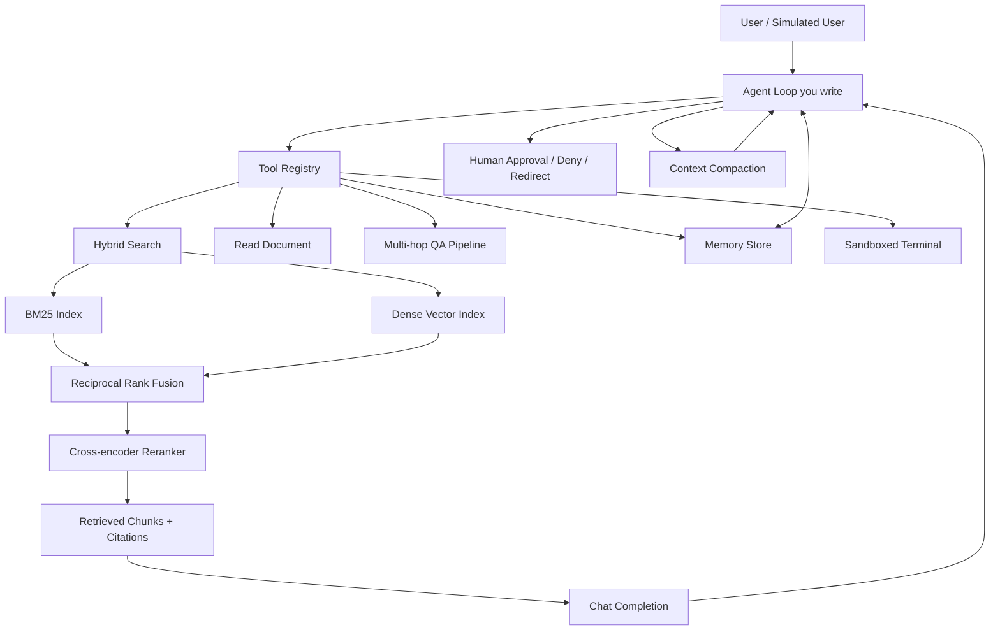

# CS329Z-Style Agentic Harness — Full Project Package

**Goal:** Build a high-signal portfolio project that mirrors what Stanford CS329Z students are building in Fall 2026 (HW1 due Oct 30, 2026).

This package contains everything needed to initialize the project in Cursor.

## Official Stanford Sources

- Course website: https://cs329z.stanford.edu/
- Logistics & HW1 description: https://cs329z.stanford.edu/logistics.html
- Project requirements: https://cs329z.stanford.edu/project.html
- Official HW1 starter code: https://github.com/cs329z/assignment1-harness
- Assignment handout (PDF): https://github.com/cs329z/assignment1-harness/blob/main/cs329z_assignment1_harness.pdf

## What Stanford Students Are Building (HW1)

From-scratch agentic harness (no LangChain/LangGraph/agent frameworks):

**Part 1 — LLM Pipelines**
- Email priority classifier
- Daily digest generator
- BM25 retriever built from scratch
- Multi-hop RAG question answering over a real corporate email archive

**Part 2 — Cardinal Agent**
- Tool registry + custom tool-calling format
- Wrap pipelines as tools
- Document retrieval
- Sandboxed terminal
- Context budget + compaction
- Memory across sessions
- Human-in-the-loop (approve / deny / redirect)
- Guardrails

Evaluation includes deterministic tests, live model tests, and simulated users.

## Recommended Project for You

**Name:** Cardinal-style Agentic Harness over a Focused Technical Corpus

### MVP
- Hybrid retrieval (BM25 + dense) with citations
- Multi-hop RAG pipeline
- Simple custom tool-calling loop (`search`, `read_document`, `answer_with_citations`)
- 30–50 evaluation questions with faithfulness + citation checks
- CLI or Streamlit UI

### Full Version
Everything above plus memory, context compaction, human-in-the-loop, terminal tool, and a full evaluation suite with error analysis.

### Explicitly Do NOT Build
- General-purpose web/browser agents
- Multi-agent swarms
- Fine-tuning
- Production auth / multi-tenant systems
- Fancy frontend

## Architecture

## Tech Stack

| Component       | Choice                          | Reason                          | Alternative              | Notes                  |
|-----------------|---------------------------------|---------------------------------|--------------------------|------------------------|
| LLM             | Claude 4 Sonnet / GPT-4.1      | Strong tool use                 | Llama 3.1 70B via Groq  | Paid APIs              |
| Embeddings      | text-embedding-3-large         | Quality/cost                    | Voyage-3 / BGE-M3       | Paid                   |
| BM25            | rank-bm25                      | From-scratch feel               | Elasticsearch           | Free                   |
| Vector store    | Qdrant (local)                 | Native hybrid                   | Weaviate / Chroma       | Free local             |
| Reranker        | Cohere Rerank 3.5              | Quality jump                    | BGE-reranker            | Paid (small)           |
| Agent loop      | Custom Python                  | Matches CS329Z                  | LangGraph later         | Free                   |
| Evaluation      | RAGAS + custom graders         | Standard + controllable         | DeepEval                | Free                   |
| UI              | Streamlit or CLI               | Fast demo                       | FastAPI + HTML          | Free                   |

You have a Cursor subscription — use it heavily for implementation.

## Data

Recommended corpus (pick one):
- 80–150 recent AI/ML papers on agents/RAG/tool use (arXiv 2024–2026)
- Cleaned Enron email subset (public)
- Public technical documentation (LangGraph, Qdrant, RAGAS, etc.)

Cleaning:
- Extract text cleanly (unstructured / pymupdf)
- Chunk by section or sliding window (512–1024 tokens, 10–20% overlap)
- Store metadata: source_id, title, date, section, chunk index
- Include unanswerable questions in the eval set

## Weekly Build Plan

| Week | Deliverable                                      | Why first |
|------|--------------------------------------------------|-----------|
| 1    | Hybrid retrieval CLI (BM25 + dense + RRF)       | Retrieval quality is the foundation |
| 2    | Multi-hop RAG pipeline with citations           | Core answering capability |
| 3    | Custom agent loop + tool registry               | The actual agent harness |
| 4    | Memory, compaction, human-in-the-loop           | Long-running sessions |
| 5    | Evaluation suite (50–100 questions) + metrics   | Proof it works |
| 6    | Streamlit UI + README + demo video              | Portfolio ready |

## Hard Parts

1. **Reliable tool-call parsing** — Models emit malformed calls. Use strict parser + retry with error feedback + few-shot examples.
2. **Context compaction** — Naive summarization loses facts. Keep last N turns + structured "facts so far".
3. **Citation faithfulness** — Force generation to only use retrieved chunks; post-check cited IDs.
4. **Hybrid fusion tuning** — Start with RRF (k=60), then add reranker. Measure recall@5.
5. **Non-trivial evaluation set** — Include multi-hop, unanswerable, and ambiguous questions. Keep a held-out set.

## Evaluation Metrics

- Retrieval: Recall@5, Recall@10, MRR
- Generation: Faithfulness, Answer relevance, Citation precision
- Agent: Task success rate, tool call count, human intervention rate

Must-have test cases:
- Multi-hop questions
- Unanswerable questions (must refuse)
- Citation stress tests

## Deployment

- Local: Docker Compose (Qdrant + app) + Streamlit
- Public: Streamlit Community Cloud, Railway, or Fly.io
- Always cache LLM and embedding calls during development

## Portfolio Angle

**Resume bullet example:**
"Built an agentic retrieval system with hybrid search, custom tool-calling loop, memory, and human-in-the-loop over a technical corpus; achieved X% faithfulness on an 80-question eval set with full citation support."

**What interviewers ask:**
- Why hybrid over pure dense?
- How did you handle context length?
- Show a failure case and what you changed
- How do you verify citations?

## Risks

- PDF extraction and chunking take longer than expected
- Building a good evaluation set is the real bottleneck
- Fixed corpus is less flashy than live data but far more controllable and closer to what CS329Z grades

## Next Steps in Cursor

1. Open this folder in Cursor
2. Start with Week 1: implement hybrid retrieval
3. Use the docs/ folder for design notes
4. Put evaluation questions in evals/

All research and sources are preserved here so you can reference them while building.
